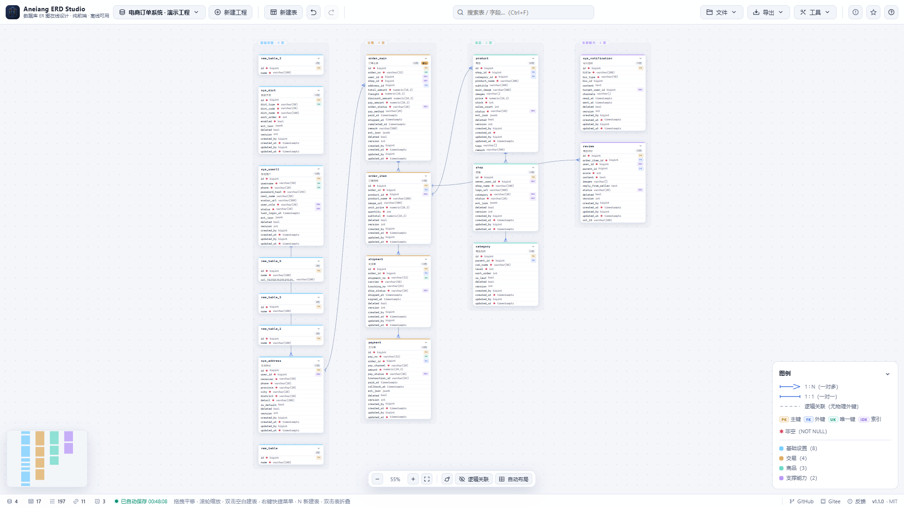
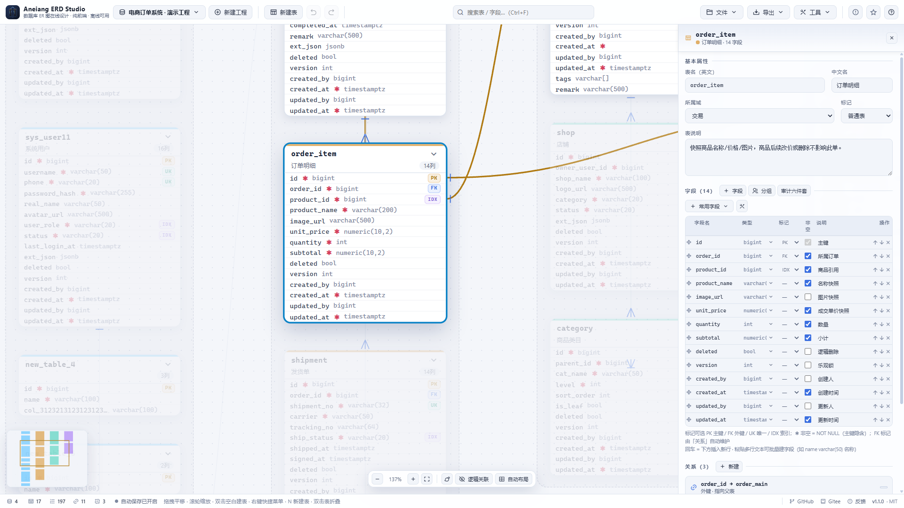

<div align="center">
  
  <h1>Aneiang ERD Studio</h1>
  <p>
    <strong>Zero-backend · Zero-dependency · Pure frontend · Offline-ready</strong>
  </p>
  <p>
    <a href="https://erd.aneiang.com/" target="_blank">
      
    </a>
    <a href="https://github.com/AneiangSoft/Aneiang.ERD-Studio/stargazers">
      
    </a>
    <a href="https://github.com/AneiangSoft/Aneiang.ERD-Studio/issues">
      
    </a>
    <a href="https://github.com/AneiangSoft/Aneiang.ERD-Studio/blob/main/LICENSE">
      
    </a>
    
    
  </p>
  <p>
    <a href="#quick-start">Quick Start</a> ·
    <a href="#features">Features</a> ·
    <a href="#screenshots">Screenshots</a> ·
    <a href="#faq">FAQ</a> ·
    <a href="#contributing">Contributing</a>
  </p>
</div>

Create and edit database entity-relationship diagrams with a visual canvas, import SQL DDL to reverse-engineer a schema, and export diagrams and data dictionaries in multiple formats. Everything happens locally in your browser — no account, no server, no telemetry.

> Interface icons are bundled locally (Remix Icon). The project makes **no third-party CDN requests**, so it is fully usable on air-gapped and intranet networks.

English | [简体中文](README.zh-CN.md)

---

## ✨ Highlights

| Feature | Description |
| --- | --- |
| 🚀 **Zero deployment** | Double-click `index.html` and you're set — no Node, no npm, no build step |
| 🔒 **Private by design** | All data stays in your browser; nothing is uploaded, no telemetry |
| 📴 **Fully offline** | Zero external requests — works on intranets, air-gapped networks, offline |
| 🎨 **6 themes** | Dark / Midnight / Light / Business Blue / Eye-care Green / Paper |
| 💾 **8 SQL dialects** | PostgreSQL / MySQL / MariaDB / SQLite / SQL Server / Oracle / DaMeng / KingbaseES |
| 📦 **6 export formats** | Project JSON / SQL / PNG / SVG / Mermaid / Excel data dictionary |
| ⌨️ **Efficient workflow** | Keyboard shortcuts, context menus, drag-to-connect, batch align, auto layout |
| 📱 **PWA ready** | Install as a desktop app — offline launch, instant startup |

## Screenshots





## Features

- **Visual editing** — create, rename, and delete tables and fields; group rows; mark PK / FK / UK / IDX; add a standard audit column set in one click; organize tables into business domains with per-domain colors; define physical foreign keys and logical relations
- **Fast modeling** — table templates (blank / standard business table / order / inventory / user / payment / audit log), a quick common-field library, multi-line paste to batch-add fields, Enter to keep adding rows, double-click an empty canvas to create a table, and Ctrl+C / Ctrl+V to duplicate tables
- **Rich interactions** — right-click context menus on the canvas, table cards, field rows, and relations; drag-to-pan, wheel-to-zoom, card drag with 4 px grid snapping; click to focus a table's relations; connect mode (child table → parent table); table / field search; 60-step undo/redo
- **Multi-select & batch** — Ctrl/Cmd-click or Shift-drag (marquee) to select multiple tables, drag them as a group, and right-click for fold/expand, **align & even distribute**, move to a zone, or bulk delete
- **Mini-map** — a live thumbnail in the bottom-left shows the overall layout and current viewport; click or drag to jump
- **Multiple projects** — create, switch, rename, duplicate, and delete projects; data auto-saves to browser localStorage with an IndexedDB rescue mirror as a fallback
- **Themes & canvas styles** — six UI themes (dark, midnight, light, business blue, eye-care green, paper), three canvas background patterns, and three connection line styles (curve / orthogonal / straight); exported images match the active theme
- **Auto layout** — arrange tables into columns by business domain and tidy up imported schemas in one click
- **PWA / local files / sharing** — installable as a PWA for offline use; open and save local `.erd` files from the File menu (Ctrl+S syncs); generate a share link (URL-encoded) to load a project on another device; a custom type library for common field types
- **i18n** — pure frontend bilingual UI (Simplified Chinese / English), switchable from the Tools menu
- **Built-in sample** — a generic e-commerce order system (12 tables / 4 domains / 11 FKs / 3 logical relations) with no real business data

### Import

| Format | Notes |
| --- | --- |
| Project JSON | Projects exported by this tool; open as a new project or merge into the current one |
| SQL DDL | `CREATE TABLE` scripts (PostgreSQL / MySQL compatible; also handles quoted, backtick, and bracket identifiers plus schema prefixes); parses columns, types, primary keys, unique keys, indexes, inline / `ALTER` foreign keys, and column comments (`COMMENT ON COLUMN` / MySQL `COMMENT`) |

### Export

| Format | Notes |
| --- | --- |
| Project JSON | Complete project data for backup, migration, or team exchange |
| SQL · 8 dialects | PostgreSQL / MySQL / MariaDB / SQLite / SQL Server / Oracle / DaMeng DM / KingbaseES, with automatic type mapping and auto-increment primary key adaptation |
| PNG / SVG | 2x-resolution raster image / lossless vector graphic, colored to the active theme |
| Mermaid `.mmd` | Render in mermaid.live, Typora, or any Mermaid-enabled Markdown viewer |
| Excel `.xlsx` | Data dictionary with four sheets (overview / tables / fields / relations), generated with zero dependencies |

## Use Cases

- **Database design reviews** — quickly sketch ER diagrams and export PNG/SVG for design docs and review meetings
- **Legacy system reverse-engineering** — import existing SQL DDL and generate a visual schema map to aid understanding and refactoring
- **Intranet / air-gapped environments** — zero external requests, pure frontend, safe to use on internal and isolated networks
- **Teaching & learning** — built-in e-commerce sample project helps understand table relations, PK/FK, and normalization
- **Individual developers** — install as a PWA, sketch ideas anytime, no login, no ads
- **Team collaboration** — exchange designs via JSON files or share links; each browser stores data independently

## Comparison

| Feature | Aneiang ERD Studio | dbdiagram.io | drawSQL | Navicat |
| --- | --- | --- | --- | --- |
| Open source | ✅ MIT | ❌ Proprietary | ❌ Proprietary | ❌ Proprietary |
| Offline-ready | ✅ Fully offline | ❌ Online only | ❌ Online only | ✅ Desktop |
| Zero deployment | ✅ Double-click to run | ❌ Requires signup | ❌ Requires signup | ❌ Install required |
| Data privacy | ✅ Local storage only | ❌ Cloud storage | ❌ Cloud storage | ✅ Local |
| Price | Free | Paid / limited free tier | Paid / limited free tier | Paid |
| SQL import/export | ✅ 8 dialects | ✅ Limited | ✅ Limited | ✅ Full |
| Visual canvas | ✅ Drag & drop + auto layout | ❌ Code-driven | ✅ Drag & drop | ✅ Drag & drop |
| PWA installable | ✅ | ❌ | ❌ | ❌ |
| Multiple themes | ✅ 6 themes | ❌ | ❌ | ✅ Limited |

> Based on publicly available information. Please open an issue if anything is inaccurate.

## Typical Workflow

1. **Create tables** — press `N` or use "New Table", starting from a template (standard business / order / user / payment…)
2. **Add fields** — append from the quick-field library in the right panel, or paste multi-line text to batch-add; `Enter` inserts a row below
3. **Create relations** — drag the dot on a table's bottom-right corner onto another table, press `C` for connect mode (stays active for multiple relations), or click "New" in the relations panel
   - If the child table lacks a foreign-key column, choose "Auto-create `xxx_id`" to add one in one click
4. **Tidy up** — auto-layout by business domain; multi-select tables and right-click to align / even distribute / fold
5. **Import & export** — import existing SQL DDL to reverse-engineer a schema; export SQL (8 dialects), PNG / SVG / Mermaid / Excel data dictionary

## 🚀 Try Online

Use it directly in your browser — no installation required:

👉 **[https://erd.aneiang.com/](https://erd.aneiang.com/)**

- Pure frontend, all data stays in your browser locally
- PWA installable for offline use
- Synced with the latest GitHub release

## Quick Start

### Option 1 — Open directly

Double-click `index.html` and use it in your browser (Chrome / Edge recommended).

### Option 2 — Local static server

```bash
# Python
python -m http.server 8080

# or Node
npx serve .
```

Open http://localhost:8080

### Option 3 — Docker deployment

#### Pull the official image (recommended)

```bash
docker run -d --name erd-studio -p 8080:80 --restart unless-stopped caco/aneiang-erd-studio:latest
```

Or with docker compose:

```bash
docker compose up -d
```

Open http://<server-ip>:8080. The image is based on `nginx:alpine` (roughly 10 MB incremental) and makes no external requests.

#### Build your own image

```bash
docker build -t erd-studio .
docker run -d --name erd-studio -p 8080:80 erd-studio
```

Multi-architecture (x86_64 / arm64) images require Docker Buildx:

```bash
docker buildx build --platform linux/amd64,linux/arm64 -t erd-studio:latest --push .
```

## Data Storage

The platform has **no backend**. All project data is saved to the **current browser's** localStorage:

- Data is tied to the browser profile. Switching browsers, machines, or clearing browser data will not migrate it automatically.
- Back up important projects regularly via **Export → Project JSON**, and restore them in a new environment with **Import**.
- Every save also mirrors the project into an **IndexedDB rescue vault** — if localStorage is cleared or a write fails, the missing projects are recovered automatically on the next launch.
- When several people use it on an intranet, each browser stores its own data; share projects by exchanging JSON files.

## Keyboard Shortcuts

| Key | Action |
| --- | --- |
| `Ctrl+Z` / `Ctrl+Y` | Undo / Redo |
| `Ctrl+F` | Focus search box |
| `Ctrl+S` | Save to localStorage immediately |
| `N` | New table (template dialog) |
| `C` | Toggle connect mode |
| `Delete` | Delete the selected table / relation |
| `Esc` | Exit connect mode / clear selection |
| `F` / `+` / `-` | Fit to window / Zoom in / Zoom out |

## Project Structure

```
├── index.html              # Entry point (no build step, no dependencies)
├── assets/
│   ├── css/
│   │   ├── base.css        # Theme variables / layout / panels / modals
│   │   ├── canvas.css      # Canvas / cards / edges / legend
│   │   └── icons.css       # Font icon subset
│   ├── js/
│   │   ├── store.js        # Data model / localStorage / undo-redo / event bus
│   │   ├── render.js       # Canvas rendering (domains / cards / edges / legend)
│   │   ├── interact.js     # Pan & zoom / drag / selection / connect mode / shortcuts
│   │   ├── editor.js       # Property panel / dialogs / project & domain management / auto layout
│   │   ├── ctxmenu.js      # Right-click context menus
│   │   ├── presets.js      # Table templates & quick-field library
│   │   ├── io.js           # Import / export (JSON / SQL / PNG / SVG / Mermaid / XLSX)
│   │   ├── sql.js          # SQL DDL parser & multi-dialect generator (8 databases)
│   │   ├── sample.js       # Built-in demo project (e-commerce, 12 tables)
│   │   └── app.js          # Startup entry
│   └── fonts/
│       ├── remixicon.woff2 # Remix Icon font (bundled locally)
│       └── NOTICE.md       # Icon license notice
├── Dockerfile              # nginx:alpine containerization (uses dist build)
├── docker-compose.yml
├── nginx.conf
├── LICENSE                 # MIT
├── README.md
└── README.zh-CN.md
```

## Technical Notes

- Zero dependencies, zero build: plain HTML / CSS / JS, no framework, no npm, no runtime external requests
- XLSX export is a minimal built-in implementation (ZIP STORE + OOXML) with no third-party library
- PNG export serializes SVG and rasterizes it on a canvas, all inside the browser

## FAQ

**Where is my data stored? Can I lose it?**
All project data is saved to the current browser's localStorage, with an IndexedDB rescue mirror as a fallback. Clearing browser data or switching browsers/machines will remove it — back up important projects regularly via "Export → Project JSON".

**How do I move to another machine or collaborate?**
"Export → Project JSON" produces a backup you can "Import" on a new environment. You can also use "Copy Share Link" to encode a project into a URL and share it directly. On an intranet, each user's browser stores data independently; exchange JSON files to collaborate.

**Which databases are supported?**
Import parses PostgreSQL / MySQL DDL; export supports 8 dialects — PostgreSQL / MySQL / MariaDB / SQLite / SQL Server / Oracle / DaMeng DM / KingbaseES — with automatic type mapping and auto-increment primary key adaptation.

**Does it work offline?**
Yes. It is pure frontend with zero dependencies and zero external requests, fully usable offline, on intranets, and in air-gapped networks. On HTTPS or localhost it can also be installed as a PWA for offline use.

**Why is there no account / cloud sync?**
The project is designed as "zero-backend, data stays private" — nothing is uploaded and there is no telemetry. For multi-device sync, use JSON files or share links.

## Browser Compatibility

Chrome / Edge (latest) recommended. The implementation is vanilla HTML/CSS/JS, so Firefox and Safari work too. PWA installation requires HTTPS or localhost.

## Roadmap

Planned features — feel free to open an issue to discuss priorities or contribute:

- [ ] **Views / stored procedures** — model and export views and stored procedures
- [ ] **Direct database connection** — connect to a real database via a backend proxy and sync schema in real time
- [ ] **Schema diff** — compare structure between two projects or two versions
- [ ] **Real-time collaboration** — CRDT-based multi-user concurrent editing
- [ ] **More SQL dialects** — TiDB, OceanBase, PolarDB, and other domestic database support
- [ ] **Plugin system** — custom field types and custom export formats
- [ ] **Mobile adaptation** — optimized canvas interaction for tablets and phones

> The roadmap is adjusted based on community feedback. Completed items move to the "Features" section.

## Acknowledgments

- Icons: [Remix Icon](https://remixicon.com) (Apache-2.0, bundled locally)
- The built-in sample is a fictional e-commerce order system with no real business data

## Contributing

Contributions of any kind — feedback, suggestions, and code — are very welcome.

- **Report issues / ideas**: open an issue on [GitHub Issues](https://github.com/AneiangSoft/Aneiang.ERD-Studio/issues) with the scenario and repro steps
- **Submit code**: fork the repo → create a branch → make changes → open a pull request
- **Translate**: the UI is bilingual (简体中文 / English); provide both languages for new strings

Conventions:

- Vanilla HTML/CSS/JS: zero dependency & zero build
- Run `node test/smoke.test.js` after making changes
- Released under the [MIT License](LICENSE)

## Support the Project

If Aneiang ERD Studio is helpful to you, here are ways to show your support:

- ⭐ **Star it** — star the [GitHub repo](https://github.com/AneiangSoft/Aneiang.ERD-Studio) to help more people discover it
- 🐛 **Report issues** — found a bug or have an idea? Open an [Issue](https://github.com/AneiangSoft/Aneiang.ERD-Studio/issues)
- 🌐 **Share it** — recommend it to colleagues, friends, or on social media
- 🌍 **Translate** — help improve the bilingual UI strings
- 💻 **Contribute code** — fix bugs, implement features, open a Pull Request

Every bit of support keeps the project moving forward — thank you!

## Repositories

- Gitee: https://gitee.com/aneiangsoft/aneiang.erd-studio
- GitHub: https://github.com/AneiangSoft/Aneiang.ERD-Studio

## License

- Code: [MIT License](LICENSE)
- Icons: [Remix Icon 4.6.0](https://remixicon.com) (Apache-2.0, bundled locally; see `assets/fonts/NOTICE.md`)
